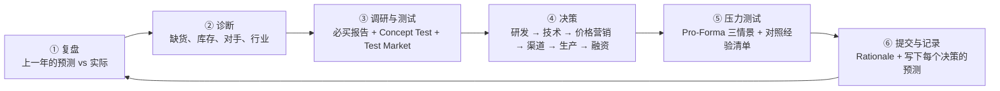

# StratSim Playbook：一套能闭环的 StratSim 打法

> **English summary.** A field-tested playbook for **StratSim Management** (Interpretive Simulations), written from one team's full run: 4 practice years plus the 6-round competition, in a 7-firm industry. The core idea is a **closed decision loop**. Every year we review the previous year's predictions against the actual results, diagnose, research, decide, stress-test, then commit and write down new predictions to check next year. Each lesson is recorded together with the condition it depends on and the evidence behind it. Our firm finished first of seven on the weighted score (98.2 vs 82.3 for second), with cumulative net income of $74.6B and a final market value of $179.5B. The playbook also ships as an agent skill: add this repository as a Claude Code plugin marketplace and the coach loads whenever you work on StratSim (see "当成 AI skill 直接用" below). The docs are in Chinese; the tables and numbers are readable without it. This is an unofficial student write-up and is not affiliated with Interpretive Simulations. Numbers come from one industry, so treat them as reference points, and check your course's rules before using shared materials.

---

## 这是什么

我们组在 StratSim 里扮演 **Firm C**，打完了 4 年练习轮和 6 轮正式比赛。这里整理了我们实际用的方法、踩过的坑，以及每一年的数据。

6 轮正式比赛打完，我们在 7 家公司里排第 1：

| 年 | 净利 | 营收 | 市值 | 股价 | 行业排名 |
|---|---|---|---|---|---|
| Start | $1,201M | $23,828M | $17,630M | $35.26 | 7 家一样 |
| Y1 | $1,318M | $22,925M | $22,908M | $38.18 | 第 2 |
| Y2 | $2,945M | $32,507M | $39,664M | $55.09 | 第 1 |
| Y3 | $9,242M | $58,444M | $75,332M | $104.63 | 第 1（Weighted Score 98.2，第 2 名 79.0） |
| Y4 | $15,578M | $79,035M | $112,858M | $156.75 | 第 1（98.2，第 2 名 83.6） |
| Y5 | $18,402M | $88,532M | $136,149M | $189.10 | 第 1（98.2，第 2 名 84.1） |
| Y6（最终） | $25,923M | $116,685M | $179,499M | $249.31 | **第 1（98.2，第 2 名 82.3）** |

最终累计净利 $74,610M（第 2 名 $28,869M），市值 $179.5B（第 2 名 $67.6B）。

## 核心思想：闭环

很多组每年都在“拍脑袋 → 交决策 → 看结果 → 再拍脑袋”。我们做的是一个闭环：



关键在第 ⑥ 步和第 ① 步之间：**每个决策交上去之前，先写下“我预计会发生什么、出结果后看哪个数字”**；结果出来后逐项对照，把对的、错的、还没结论的分别记进经验清单。下一年做决策前，先对照这份清单检查一遍。

这样做两年以后，你的经验清单会比任何攻略都准，因为它来自你自己的行业。

## 怎么读

| 你是谁 | 先读 |
|---|---|
| 第一次玩，想知道怎么上手 | [01 规则与评分](docs/01_规则与评分.md) → [02 闭环决策流程](docs/02_闭环决策流程.md) |
| 正在做某一年的决策 | [02 闭环决策流程](docs/02_闭环决策流程.md) 里的检查清单 + [03 各板块打法](docs/03_各板块打法.md) |
| 想快速知道哪些能做、哪些别做 | [04 经验清单](docs/04_经验清单.md) |
| 想看一家公司从头到尾怎么打的 | [05 正式比赛逐年复盘](docs/05_正式比赛逐年复盘.md) |
| 只玩过练习轮 | [06 练习轮 vs 正式比赛](docs/06_练习轮vs正式比赛.md) |
| 要做 BoD 汇报的作业 | [07 BoD 作业经验](docs/07_BoD作业经验.md) + [examples/](examples/) |
| 想让 AI 按这套方法陪你做决策 | [skills/stratsim-playbook](skills/stratsim-playbook/SKILL.md)，安装方法见下一节 |

其他文件：

- [examples/](examples/)：我们交过的 C4 作业（Strategy worksheet、Financial worksheet、One-Page BoD Executive Summary），已匿名。
- [data/](data/)：练习轮和正式比赛的对照表（Excel），每年做了什么、结果、结论都在里面。
- [archive/](archive/)：原始的试错记录，比 docs 详细得多，也乱得多。docs 里的每条结论都能在这里找到出处。

## 当成 AI skill 直接用

这套打法也整理成了一个 skill（[skills/stratsim-playbook/SKILL.md](skills/stratsim-playbook/SKILL.md)）。装好以后，你问 AI 任何 StratSim 的问题，它会按闭环流程走：先要你上一年的报告，对照预测和实际，再按顺序帮你定研发、价格、排产、融资，用 Pro-Forma 做压力测试，最后列出下一年要核对的数字。

**Claude Code**（在终端里运行）：

```bash
claude plugin marketplace add MrGreyBear/stratsim-playbook
claude plugin install stratsim@stratsim-playbook
```

在会话里也可以用 `/plugin marketplace add MrGreyBear/stratsim-playbook`，再 `/plugin install stratsim@stratsim-playbook`。装好后直接问 StratSim 的问题就会自动用上，也可以输入 `/stratsim:stratsim-playbook` 手动调用。

**只想要 skill 文件**：把 `skills/stratsim-playbook/` 整个文件夹复制到 `~/.claude/skills/`。别的支持 SKILL.md 的 AI 工具，复制到它们的 skills 目录。这样装的话，skill 里指向 docs 的链接要到 GitHub 上看。

skill 是英文写的，方便不同的 AI 工具读；它会用你提问的语言回答。

## 几句话版本

如果你只有 5 分钟：

1. **先对准尺寸**。Focus Group 说 too small / too big，别的属性再好也卖不动。
2. **定价用 Test Market，不用 Concept Test**。Concept Test 会夸大价格敏感度；缺货的车每年提价 5–10%，份额基本不变。
3. **扩产要提前一年**。扩 1 辆产能一次约 $700，超产 1 辆每年要付 $2,200 以上。
4. **抢没人做的细分市场**。我们的 Canyon（5U）和 Cosmo（4F）上市第一年就是细分市场第一。
5. **选新车看单车毛利，不看 Likely to buy**。好几个 Likely to buy 很高的细分市场几乎不赚钱。
6. **前两年用增发把高息短贷还清**，负债清零后评级升到 AAA，之后靠经营现金流就够。
7. **按销量只有计划的 90% 和 80% 检查现金**，别等系统按 7.5% 强制借钱。
8. **每条经验都写清楚它在什么条件下成立**。条件变了，结论可能反过来（比如“缺货时加广告是浪费”）。
9. **偏好度靠新车和升级，不靠加营销**。我们只加营销那年偏好度反而降了，四款升级加一款新车那年涨了 2.2 点。
10. **最后一年排满产能 100%**。卖不掉的车按成本进库存，净利几乎不受影响；需求多出来的交给 Flex，别直接排到 100% 以上。

## 免责声明

- 这是学生自己写的总结，和 Interpretive Simulations 以及任何课程都没有官方关系。
- 数据来自我们这一个行业（7 家公司）。你的对手、经济环境和系统设置可能不同，数字只能当参考。
- 用之前请先看你们课程的规定，确认可以参考公开的攻略。
- 文中标 [推断] 的是我们根据数据推出来的，系统没有直接给。
