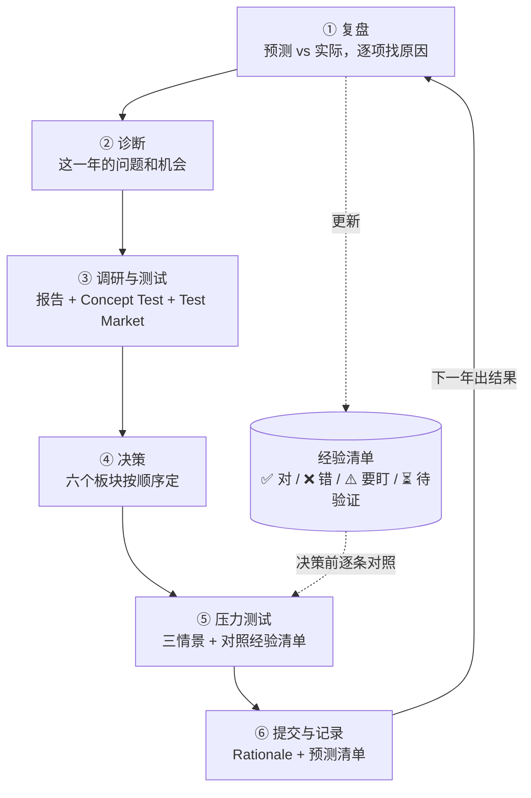
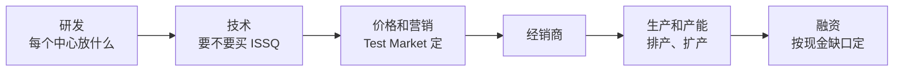

# 02 闭环决策流程

这是整套打法的核心。每一年都按同样的六步走，最后一步写下的预测，就是下一年第一步要检查的东西。

为什么要闭环：StratSim 每个行业的对手、经济环境都不一样，别人的结论不一定适用。只有“写下预测 → 看结果 → 找原因 → 改规则”这个循环，能让你的判断一年比一年准。我们的经验清单有一半是自己被结果打脸以后改出来的。

---

## ① 复盘：上一年的预测 vs 实际

**什么时候做**：每次推进出结果后，先做这一步，再碰新的决策。

**去哪看**：Company 下的 Dashboard、Income Statement（含 COGS 和 Extraordinary Items 两个子页）、Product Contribution、Manufacturing（看每款车的 Comment：shortage、Upgraded、New）、Cash Flow、Balance Sheet；Competition 下的 Financial Summary、Marketing Communications、Distribution；门户网站的 Results。

**怎么做**：把上一年第 ⑥ 步写下的每条预测拿出来，填这张表：

| 项目 | 怎么预测的 | 预测 | 实际 | 差距 | 原因 |
|---|---|---|---|---|---|
| Cafav 份额 | Test Market（$22,385 + 广告 100 / 70） | 5.3% | 6.0% | +0.7 点 | Test Market 假设对手不改价，实际对手也提价了 |
| 全行业销量 | 练习轮经验打折 | 10,100K | 8,961K | −11% | 每家产能都小，全行业被产量卡住 |
| 净利 | Pro-Forma | $1,237M | $1,318M | +$81M | 多卖的车总体赚钱 |

（这是我们 Y1 的真实例子。）

然后再做三件事：

1. **每个指标为什么涨、为什么跌**：利润表、每款车的销量和贡献、资产负债表，逐行写原因。BoD 汇报正好要讲这些。
2. **同行业对比**：7 家的净利、毛利率、营销、研发、股价、市值、负债、偏好度、库存放在一张表里，写清楚第一名为什么是第一。我们 Y1 排第 2，对比后发现第 1 名 G 几乎没投资研发，短期净利高，长期没有新车，所以没去学它。
3. **更新经验清单**：预测对了的记 ✅，错了的记 ❌，**每一条都写上它成立的条件**。

> **教训要带条件**：Y1 我们发现 Cameo 超产不划算，Y2 照搬把 Cameo 的 Flex 关了。检查时才发现条件已经变了：提价后 Cameo 单车毛利 $3,160，已经比超产成本高，多产是赚钱的。改回来以后，我们把“每条教训写清楚成立条件”定成了规则。

## ② 诊断：这一年的问题和机会

按这个顺序问自己：

| 问题 | 看哪里 | 如果是 |
|---|---|---|
| 哪款车缺货？ | Manufacturing 的 Comment：shortage >30% / 10–30% / <10% | 还缺货就提价，同时加产能（扩产要提前一年） |
| 哪款车压了库存？ | Manufacturing 的 Inv. 和 Days | 下一年少排；要升级的车，前一年就少排 |
| 哪款车在细分市场里属性落后了？ | Focus Group：size too small / too big，hot button 的 best / avg / worst | 尺寸不对先改尺寸；hot button 被对手追上就升级 |
| 哪个细分市场没人做好？ | Microsegment 的 Leading Vehicle 和 New Microsegments；Focus Group 里全是 too small / too big | 抢先进入（我们的 Canyon、Cosmo、Chow 都是这样来的） |
| 对手在干什么？ | Industry News、Competition 各页 | 谁宣布了新类别（下一年就上市）、谁升级了、谁在压库存（可能降价） |
| 行业规模和经济环境？ | Economic Outlook | 行业销量按系统预测的约 75–77% 估；GDP 下行时不排满 |
| 现金够不够？ | Cash Flow、Balance Sheet | 不够就主动增发，别等系统强制借钱 |

## ③ 调研与测试

**必买**（课程也要求）：自己目标细分市场的 **Microsegment** 和 **Focus Group** 报告。要考察新细分市场时也买，报告很便宜。

**测试**：两个工具每年各 10 次，**用满，但要分配好**：

| 工具 | 用在 | 能看到 | 注意 |
|---|---|---|---|
| Concept Test | 新车、升级版、开发中的项目 | Likely to buy + 每项属性的评价 | 用来**筛选配置和价格区间**，别单独拿来定价 |
| Test Market | 已经在卖的车 | 份额 + 贡献变化（Net Contribution Impact） | 用来**定价格和营销预算**；价格只能在 ±10% 内测 |

分配建议：

- 每款在卖的车先测“提价 5–10%”，再测“提价 + 加广告”；看贡献变化最大的组合。
- **各留 1–2 次测最终组合**。我们 Y2 最终组合是插值出来的，没原样测过，后来每年都留 2 次。
- Y5 我们在 Test Market 用完以后才想加营销，结果没法测了。**改营销或价格前先看还剩几次。**

## ④ 决策：六个板块按顺序定

顺序很重要，后面的板块要用前面的结果：

每个板块的具体做法见 [03 各板块打法](03_各板块打法.md)。这里只列每个板块定完要满足的条件：

| 板块 | 定完要满足 |
|---|---|
| 研发 | 每个中心都有项目；升级先对准**上市那年**的尺寸中间值；新车先算单车毛利（售价 × 0.88 − Base Cost） |
| 技术 | 只买接下来的升级用得上的；剩下的年数能收回成本 |
| 价格和营销 | 每款车的最终组合都测过；营销约占营收 2–2.5%；缺货的车不加广告 |
| 经销商 | 在上限内加，优先覆盖率低的区域 |
| 生产和产能 | 排产 = Test Market 份额 × 合理的行业规模；产能分给单车贡献最高的缺货车；利用率不超过约 110%；下一年要的产能今年就扩 |
| 融资 | 保守情景下现金不为负；有高息债就还；多余现金买 CD（上限 $10B） |

## ⑤ 压力测试

交之前必须做三件事：

**1. Pro-Forma 三情景**

Pro-Forma 只算一种情景，而且你填多少销量它就按多少算。我们每年都按下面四种算一遍：

| 情景 | 销量 | 看什么 |
|---|---|---|
| 乐观 | Flex 加满（计划的 110%） | 超产能费会不会吃掉利润 |
| 基准 | 计划 | Pro-Forma 原样 |
| 保守 | 计划的 90% | 现金还是正的吗？压多少库存？ |
| 很差 | 计划的 80% | 会不会被系统强制借钱？ |

练习轮 Y3 我们只看了一种情景，结果被系统按高息强制借了 $751M。

**2. 对照经验清单逐条查**

把 [04 经验清单](04_经验清单.md) 里的每一条 ❌ 和这一年的决策对一遍。我们正式比赛 D4 的初版就犯了一条老错误：按 Likely to buy 选了两款新车，单车毛利只有约 $2,600 和 $3,900，其中一款还会抢自家卡车的市场。复查时对出来，两款都取消了。

**3. 系统检查**

- Decision Summary 逐项核对。
- **Decision Alerts 必须为 0**。
- Timeline 看哪些车今年上市、哪些产能明年到位。

## ⑥ 提交与记录

**Rationale**：用英文写，结构可以照我们的：上一年回顾 → 市场 → 调研 → 研发 → 技术 → 价格和营销 → 经销商 → 生产 → 融资。每个决定都写依据（测试数据、上一年的结果），没测过的东西直说没测过。

**预测清单（最重要）**：每个关键决定写一条“等结果出来要看什么”：

| 决定 | 预测 | 出结果后看 |
|---|---|---|
| Cosmo 定 $44,000（+10%） | Test Market 份额不变，还是缺货 | Manufacturing 的 Comment、4F 份额 |
| 营销加到营收的 2.5% | 偏好度保持第 1，Cafav 不压库存 | Firm Preference、Cafav 的库存天数 |
| 分红每股 $2 | 对股价影响不大 | 股价和不分红的对手比 |

（这是我们 Y5 的真实例子。）

**截止前**：

- 再看一次 Decision Log，确认没有别人（或别的程序）改过决策。
- 把页面的年份切回当前年份。看历史数据时切到过去的年份，忘了切回来容易看错。

---

## 一个完整闭环的例子：Canyon 的排产

| 年 | 决策 | 结果 | 改了什么规则 |
|---|---|---|---|
| Y3 | 新车 Canyon 首年按推断量 680K，排 650K | 只卖 585K，压 65K；Flex 没有自动减产 | 新车首年按推断量的 85–90% 排；不靠 Flex 防库存；对手已宣布的车按“当年就上市”算 |
| Y4 | Canyon 排 600K + 库存 65K，把多出来的产能给了 Cafav、Crash | Canyon 缺货 >30%，Cafav、Crash 反而压了 74K | 产能按单车贡献分配：缺货的高毛利车先排 |
| Y5 | Canyon 820K、Cosmo 350K 加最多，Cafav、Crash 按上一年销量排 | 待验证 | — |

每一年的规则都是上一年被结果“纠正”出来的，这就是闭环。
